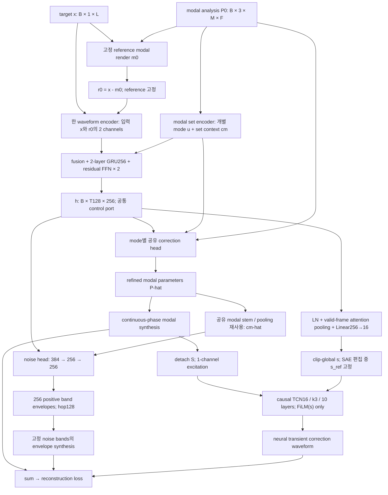

# Modal-conditioned joint modal / noise / transient decoder

작성·최종 설계 확정: 2026-11-05. 상태: **구현 기준 설계 확정, joint NN 구현·학습 대기.** 이 문서의 숫자는 명시된 layer의 산술 예산이다. 품질, peak VRAM, CPU realtime 성능을 측정한 값이 아니다. 새 modal adapter/renderer의 기존 구현 상태는 §4에 구분한다.

## 1. 확정할 구조와 연구 질문

한 waveform encoder와 modal set encoder가 공통 temporal representation을 만들고, decoder는 다음 순서로 동작한다.

1. 추출된 개별 mode를 보존하면서 frequency / amplitude를 작게 refine한다. Initial sine phase는 mode마다 분석값 하나로 고정하고 dphi head를 두지 않는다.
2. **실제로 refine한 modal parameter**를 다시 요약하여 256 noise-band envelope를 예측한다.
3. 보정된 modal waveform S를 detach하여 TCN에 입력한다. 외부 조건은 h를 clip 전체에서 pool한 s16 하나이며 시간 불변 FiLM만 사용한다. TFiLM은 사용하지 않는다. N과 T는 서로를 보지 않으므로 S가 준비된 뒤 병렬 계산할 수 있다.
4. 세 synthesis 결과를 더하고 **그 합을 target과 비교하여 한 번에 학습**한다.

연구의 중심은 **(a) 분석 mode를 보존하는 modal correction, (b) 보정된 modal을 보는 noise, (c) DSP parameter를 거쳐 작동하는 post-hoc SAE control**이다. TCN은 새 transient 모델이라는 contribution이 아니라, latent sequence에서 전체 waveform을 직접 생성하는 자유도를 줄이면서 attack을 보완하는 경로다. 이 결합의 reconstruction/control 성능은 실험으로 판단해야 한다.

최종 synthesis는 다음과 같다.

\[
S=\operatorname{ModalSynth}(\hat P),\quad
N=\operatorname{NoiseBandSynth}(a),\quad
T=\operatorname{TCN}(\operatorname{stopgrad}(S);\operatorname{FiLM}(s)),
\qquad \hat x=S+N+T.
\]



### 유지하는 조건

- 48 kHz mono, 기존 variable-length sample과 modal cache, 현재의 pack 내부 split 정책을 사용한다. 새 annotation이나 synthetic dataset은 요구하지 않는다. Control은 joint model 학습 후 h 위의 post-hoc SAE를 별도로 학습한다.
- Noise band 수 **256**, audio feature / noise envelope hop **128 samples = 2.667 ms**.
- Modal correction은 native modal frame grid에서 예측한다. Nominal hop은 **256 samples = 5.333 ms**이며 실제 cache timestamp가 우선한다.
- 새 joint 경로의 NN, noise synthesis, loss와 modal phase 누적·sin은 FP32이며 matmul은 `highest`다. Cache frequency의 radians/sample→cycles/sample 변환만 새 data adapter의 CPU loading에서 FP64로 수행한 뒤 FP32로 내린다. 기존 radians 기반 baseline API와 cache 포맷은 유지한다.
- iSTFT synthesis, Vocos 계열, PCA / ICA control, pretrained codec, quantization, GAN, diffusion, per-example iterative fitting을 사용하지 않는다. Post-hoc SAE와 TopK 활성 선택은 사용한다. Random latent direction은 control로 사용하지 않는다.
- Reconstruction model의 NN은 한 optimizer로 처음부터 joint training한다. 그 학습이 끝나면 joint model을 freeze하고, cached h에 별도 optimizer로 post-hoc SAE만 학습한다. SAE 때문에 joint model을 재학습하지 않는다.

128 hop은 parameter clock이지 최종 plugin latency가 아니다. Encoder와 modal analysis는 noncausal이고 s는 sample-load 시 clip 전체에서 계산한다. s를 고정한 TCN의 convolution 경로는 causal이다. Sample-load analysis와 실제 callback 구현을 구분한다.

## 2. 근거와 contribution의 경계

**기존 연구가 이미 한 것.** DDSP는 shared-bottom NN에서 서로 다른 synthesis parameter head를 내보낸다 [R1]. DrumBlender는 modal + noise + neural transient의 연결을 비교했고, transient TCN의 onset 개선과 decay artifact를 함께 보고했다 [R3]. NoiseBandNet은 noise-band envelope 합성 및 impact 계열 sound effect를 이미 다룬다 [R2]. 따라서 “joint”, “percussion에 noise bands”, “transient NN 추가” 각각은 독립적인 novelty가 아니다.

**우리의 구체적인 차이.** 고해상도 modal analysis를 보존하고 개별 mode correction을 reference에 anchor한다. Noise head는 **그 correction 결과를 본다**. 학습 후 h 위의 SAE delta를 편집하면 modal/noise parameter가 바뀌며, TCN의 s_ref는 neutral 값에 고정한다. TCN은 편집된 modal waveform에 반응하지만 h_edit에서 직접 새 conditioning을 받지 않는다. 이 결합이 reconstruction과 편집 일관성을 개선하는지가 contribution의 실질이다.

**TCN의 논문상 위치.** 직접적인 latent-to-waveform 경로를 제거하고 neural correction을 modal excitation과 clip-global 저차원 conditioning으로 제한한다. 이는 역할 침범을 줄이려는 inductive bias이지 branch 분리나 공명/noise 비흡수의 보장이 아니다. s의 이름이 strike latent라고 해서 strike 정보만 담는다고 주장하지 않는다. TCN 자체를 새 transient 모델로 내세우지 않는다.

DDSP/SMS 철학과 충돌하지 않는다. NN이 DSP parameter를 함께 추론하고 differentiable synthesizer를 통과한 waveform으로 학습하기 때문이다. 다만 transient 부분은 neural waveform synthesis이며 전체 시스템이 순수 parametric DSP만으로 구성된 것은 아니다. 이 hybrid 성격은 명시한다 [R1, R3].

2025년 Modulation Discovery는 학습된 modulation과 routing의 유용성 및 해석성 / matching 정확도 사이의 trade-off를 보여준다 [R7]. 2026년 PLAUD는 NoiseBandNet과 latent performance를 이미 연결한다 [R8]. 이들은 control의 선례이며 우리 구조의 성공을 증명하지 않는다. Disentangled knob나 최초 latent DDSP를 주장하지 않는다.

## 3. 입력 선택: target과 reference residual을 함께 사용

### 비교한 세 접근

| 입력 | 장점 | 중요한 약점 | 결정 |
|---|---|---|---|
| `r0 = x - m0`만 | 아직 설명되지 않은 성분이 직접 드러남 | modal phase 오차로 생긴 상쇄 성분도 residual에 들어감; 원래 target view가 없음 | 단독 사용하지 않음 |
| `x`만 + modal tokens | 원래 waveform 정보 보존 | 이미 설명된 modal과 잔여 성분의 관계까지 encoder가 학습해야 함 | 가능하지만 기본안으로 채택하지 않음 |
| `[x, r0]` 두 channel + modal tokens | target과 분석 후 잔여 성분의 관점을 한 encoder에서 제공 | 선형적으로 중복된 입력; 더 좋은 품질을 자동 보장하지 않음 | **채택** |

\[
m_0=\operatorname{ModalSynth}(P_0),\quad r_0=x-m_0,
\qquad z_a=E_a([x,r_0]).
\]

`[x,r0]`는 `[x,m0]`와 가역적인 선형 변환 관계다. 첫 Conv가 선형이므로 두 입력 방식의 표현력 차이나 정보량 증가를 주장하지 않는다. Residual 관점을 명시하면서 source waveform을 보존하는 engineering 선택이다. 특정 논문이 이 정확한 입력 조합의 우월성을 검증한 것은 아니다.

두 개의 encoder를 만들지 않는다. 1→16 kernel7 Conv를 2→16으로 바꾸는 추가 parameter는 **112개**다. 전체 encoder cost는 사실상 그대로다. Residual 개념은 SMS 및 DrumBlender의 modal / noise 역할 구분에서 가져오되, residual을 noise의 ground truth로 취급하지 않는다 [R1, R3].

### Reference와 gain

- `P0`는 추출 결과이며 학습 대상이 아니다. `m0`, `r0` 계산은 `no_grad`다.
- Sample마다 `g = max(max(abs(x)), 1e-4)`를 저장한다. `x`와 modal amplitude를 **같은 g**로 나누고 `r0`도 이 좌표계에서 계산한다. 합성 후 전체 결과에 g를 다시 곱한다.
- Branch별 독립 peak normalization을 하지 않는다. Source와 modal amplitude의 상대 크기를 보존해야 한다.
- Source가 무음이면 낮은 gain floor 아래에서 그대로 처리한다. 최종 audio를 peak normalize하거나 clamp하여 loss에 넣지 않는다.
- `r0`는 sample-load reference다. Modal refinement 또는 knob 편집 후 `x - edited_modal`을 다시 encoder에 넣지 않는다. 이것은 편집을 원래 target 쪽으로 되돌리는 경로가 된다.
- x/r0는 공통 encoder 입력이다. TCN의 audio 입력은 detach(S) 1채널이고 외부 조건은 s 하나다. x/r0, 시간별 h, cm_hat, noise envelope/carrier, onset impulse를 TCN에 직접 전달하지 않는다. s는 h에서 유래하므로 target 정보의 간접 conditioning은 남는다.

## 4. Tensor / 시간축 계약

| 기호 | Shape | 의미 |
|---|---|---|
| `x` | `[B,1,Lpad]` | 저장 padding을 포함한 waveform; 실제 길이 `lengths[B]` 별도 |
| `P0` | `[B,3,M,F]` | cycles/sample frequency, amplitude, initial sine phase(radians) |
| `observed` | `[B,M,F]` bool | 실제 modal 관측; 기본 cache에서는 amplitude > 0 |
| `mode_valid` | `[B,M]` bool | 적어도 한 번 관측된 mode |
| `modal_times` | `[B,F]` | source sample index 단위의 실제 modal frame 중심 |
| `za` | `[B,T,192]` | waveform encoder output; `T=Lpad/128` |
| `u` | `[B,M,F,64]` | mode identity를 보존한 modal hidden |
| `cm`, `cm_hat` | `[B,T,128]` | 원래 / refined modal set context를 audio clock에 정렬한 값 |
| `h` | `[B,T,256]` | 공통 temporal representation; 편집 가능한 port |
| `rho` | `[B,T]` | audio feature block의 실제 sample 수/128; padding frame은0 |
| `s`, `s_ref` | `[B,16]` | 학습 시 clip-global strike conditioning / inference neutral cache |
| `gamma`, `beta` | 층마다 `[B,16]` | s에서 한 번 계산하는 시간 불변 FiLM 계수 |
| `df`, `da` | `[B,M,F]` | log-frequency / log-amplitude correction |
| `phi0_ref` | `[B,M,1]` | 분석된 mode별 initial sine phase(radians); 학습하지 않고 frame 축으로 반복 |
| `a` | `[B,T,256]` | positive noise-band amplitude envelopes |
| `m`, `n`, `tau` | `[B,1,L]` | 실제 길이로 crop한 branch waveform |

설명을 위한 B는 batch 축이다. 첫 구현은 batch를 item list로 전달한다. 각 item을 실제 길이와 native modal frame 수로 처리하고 scalar loss를 평균한다. 전체 native grid에서 진폭이 정확히 0인 mode slot만 CPU에서 제거한다. Length bucketing / 효율적인 batch vectorization은 나중에 의미를 보존하며 구현할 수 있다.

### 두 clock을 강제로 같은 길이로 늘이지 않는다

Audio input은 오른쪽을 128의 배수까지 zero pad한다. 새 encoder의 downsampling padding은 §5에서 정한 방식으로 사용하여 frame center를 다음과 같이 고정한다.

\[
t_j^{a}=128j+63.5,\qquad j=0,\ldots,T-1.
\]

마지막 block이 partial이어도 실제 sample이 하나 이상 있으면 valid frame이다. `center < L`만으로 masking하면 64 samples 미만 clip에 valid frame이 하나도 없어질 수 있으므로 block의 실제 sample 수로 판단한다.

Native modal cache의 현재 보간 규약은 다음과 같다.

\[
t_j^m=(j+0.5)\frac{L_{analysis}}{F}-0.5.
\]

`L_analysis=analysis_num_samples`, 실제 loss 길이는 `L=num_samples`다. 둘이 다르면 modal frame 전체를 L에 압축하지 않는다. Native timestamps에서 L 구간을 render한다. 새 구현의 loader는 이 metadata를 반환해야 한다. 현재 `AudioWithParametersDataset`의 `preserve_analysis_clock` 옵션만 켜고 이후 `F.interpolate(size=L)`를 호출하는 것으로는 충분하지 않다.

- Modal→audio context: `t_m`에서 `t_a`로 timestamp 기반 linear interpolation.
- `h`→modal head: `t_a`에서 `t_m`으로 timestamp 기반 linear interpolation.
- L 바깥에만 있는 modal frame에는 reconstruction loss에서 간접적으로만 gradient가 생길 수 있다. 실제 L 안의 보간 endpoint가 되는 frame까지 포함하고 나머지 padded frame은 제외한다.
- Context 보간은 valid data의 endpoint hold를 사용한다. Mode amplitude 보간과 missing frequency 처리는 별도의 renderer 규칙을 따른다.
- Learned feature interpolation은 허용한다. 이 보간은 iSTFT synthesis가 아니다.

### Analysis padding을 연산별로 처리하는 규칙

단순한 `modal_time < L` mask로 통일하지 않는다. Sample q=0…L-1에 대한 native linear interpolation weight를 `b_j(q)`라고 하고, `beta_j=sum_q b_j(q)`를 정의한다. Endpoint hold도 이 weight에 포함한다. **S={j: beta_j>0}**가 실제 waveform에 기여하는 frame 집합이다. 따라서 L 밖의 마지막 보간 endpoint도 필요하면 S에 들어간다. 극단적으로 짧은 clip도 적어도 한 endpoint를 갖는다.

- Reference renderer는 전체 native P0와 clock을 보존하고 L까지만 render한다. S 밖의 값을 제거해 reference를 바꾸지 않는다.
- Modal encoder의 temporal block에는 S 양쪽으로 최대8 native frames의 halo를 준다. 두 block의 반경2+6에 해당한다. Halo 바깥은 zero이며, 최종 u와 set pooling에는 S만 남긴다. 두 block 사이에서 S만으로 너무 일찍 mask하지 않고, halo 안의 observation mask를 유지한다.
- Mode-valid는 S 안에서 관측된 적이 있는 mode다. Analysis padding에만 존재하는 mode는 modal context나 correction에 참여하지 않는다.
- Frame별 df/da는 S의 observed frame에서만 예측한다. S 밖의 df/da는 0으로 두어 원래 frequency/amplitude를 유지한다. Refined set context도 S에서만 pool한다.
- Initial phase는 분석값을 frame0을 포함한 모든 native phase frame에 그대로 반복한다. Frame0이 unobserved여도 값을 지우지 않는다. Renderer는 이 initial value를 읽으며 dphi 예측이나 phase pooling은 없다. Invalid mode는 amplitude support가 0이므로 소리를 내지 않는다.
- Frequency/amplitude correction statistics는 `beta_j*observed_j`로 평균한다. L 밖 endpoint의 영향을 한 frame 전체로 과대평가하지 않는다. Modal anchor loss와 phase energy pooling은 사용하지 않는다.
- 마지막 partial audio block의 context lookup 시간은 `[0,L-1]`로 clamp한다. 유효 waveform 밖의 query 때문에 추가 padding frame을 읽지 않는다.
- h→modal 보간은 h의 endpoint hold를 사용한다. F 차원을 index로 압축하거나 audio padding 길이에 맞춰 modal clock을 바꾸지 않는다.

### FP32 wrapped-cycle renderer 계약과 검증

`JointResynthesisDataset`은 기존 cache를 읽어 CPU에서 `nu=(omega.float64/(2*pi)).float32`로 변환한다. Amplitude와 initial phase(radians)는 유지하고 파일은 바꾸지 않는다. Model 내부에서 ν를 radians/sample로 다시 변환하지 않는다. Dataset adapter는 analysis_num_samples와 physical length도 보존한다.

새 경로는 `CyclesModalSynth` / `modal_synth_cycles`를 사용한다. **FP32-only는 새 joint synthesis graph의 계약이다.** 예전 radians renderer와 baseline 학습 코드는 이 checkout에서 제거했다. Joint NN은 이 adapter와 renderer를 사용한다. CUDA에서 Triton을 사용할 수 있으면 동일한 FP32 Kahan block carry를 단일 kernel로 실행한다.

Sample-rate로 보간하고 inactive-endpoint hold를 적용한 ν를 고정 `phase_block_size=256` sample blocks로 자른다. 이 경계는 modal frame timestamp와 독립적이다. Block 내부는 local FP32 cumsum, block 합계는 pairwise tree reduction, carry는 Kahan compensated accumulation 후 turn frac을 사용한다. 정수 turn 제거는 매 block 적용하며 두 단계64-frame grouping은 사용하지 않는다. Block size는 인자다. Partial block은 zero pad 후 원래 길이로 crop한다.

Kahan recurrence는 **sample block별 순차 연산**이고 modal frame별 loop는 아니다. 2π는 sine argument 직전에 곱하며, 접힌 phase를 loss나 NN feature로 사용하지 않는다. Initial phase는 radians 상태로 그 argument에 더한다. Analytical backward는 reverse cumsum이며 동일 연산 순서의 non-reentrant checkpoint 재계산에서 output/gradient 일치를 확인했다.

2026-11-05, PyTorch2.7.1+cpu, CPU, 20초/48kHz, initial phase0, block256에서 측정했다. 기준은 **cache ω를 FP64에서 cycles로 변환한 뒤 FP32로 내린 동일 tensor를 FP64로 누적하고 실제2π를 곱한 값**이다. 아래는 circular phase error이며 cache ω의 원래 주파수 추정/양자화 오차를 평가한 것이 아니다.

| Constant frequency | 마지막 sample 오차(rad) | 최대 절대 오차(rad) |
|---|---:|---:|
| 1kHz | +1.474618817e-10 | 1.867592797e-6 |
| 12kHz | +2.331275299e-11 | 8.759792252e-8 |
| 20kHz | +3.495319776e-8 | 2.564311081e-5 |
| 23.9kHz | +4.946302221e-10 | 4.812379948e-5 |

네 경우 모두 최대오차 **1e-4 rad 이하**를 통과했다. 시간에 따라 변하는 임의 frequency나 GPU에 대한 동일 상한은 주장하지 않는다. 추가로 periodic VJP, checkpoint output/gradient 일치, analysis extent가 긴 경우 crop 일치, sample0 carrier, finite gradients, FP64 saved tensor 부재, partial/non-power-of-two block 처리를 CPU에서 확인했다. 임시 검증 파일은 만들지 않았다.

목적은 DDSP 공식 [angular_cumsum](https://github.com/magenta/ddsp/blob/main/ddsp/core.py#L724)과 같은 장시간 누적 오차 억제다. 구현은 radians modulo 대신 cycle 누적과 compensated carry를 사용한다. Phase tensor 한 장은937.5→468.75 MiB지만 전체 peak VRAM/속도는 서버 profiling 전에는 claim하지 않는다.

## 5. Waveform encoder: 한 경로, output192, hop128

Codec의 pretrained encoder를 불러오지 않는다. 현재 SoundStream encoder의 dilated residual waveform feature extractor를 기반으로 input / output과 **정확한 downsampling alignment**를 수정한다. 이 layer family는 DrumBlender / SoundStream 및 DAC의 waveform modeling 선례를 이용한다 [R3, R5]. NN 부분 전체를 새로 유행하는 module로 교체하는 것 자체를 contribution으로 삼지 않는다.

| 단계 | 연산 | Output `[B,C,time]` |
|---|---|---|
| Input | Conv1d 2→16, k7, p3 | `[B,16,Lpad]` |
| Block1 | RU16(d=1,3,9), Conv16→32, k4, s2, p1, ELU | `[B,32,Lpad/2]` |
| Block2 | RU32(d=1,3,9), Conv32→64, k4, s2, p1, ELU | `[B,64,Lpad/4]` |
| Block3 | RU64(d=1,3,9), Conv64→128, k8, s4, p2, ELU | `[B,128,Lpad/16]` |
| Block4 | RU128(d=1,3,9), Conv128→256, k16, s8, p4, ELU | `[B,256,T]` |
| Output | Conv256→192, k3, p1; transpose | `[B,T,192]` |

`RU_C(d): y=Conv1x1(ELU(Conv7_d(x))); output=x+ELU(y)`. Conv7의 padding은 `3*d`다. 모든 Conv에는 bias가 있고, weight normalization과 learned activation parameter는 없다.

**Alignment:** 현재 generic `Pad`는 even kernel `k=2s`에 `p=s-1`을 쓴다. 새 encoder는 **p=s/2**를 사용하여 128-sample block center와 정렬한다. 기존 encoder class를 무조건 수정하여 baseline까지 바꾸지 않고, 새 downsample block에서 명시한다. Padding은 parameter 수에 영향을 주지 않는다.

이 layer 정의에서 encoder receptive field는 2,334 samples, 약48.6 ms다. 이후 GRU는 clip 앞부분의 history를 가진다. Center와 receptive field 계산은 구현할 때 numerical alignment로 확인할 계약이며, hop을 latency로 해석하지 않는다.

## 6. Modal encoder: 개별 mode를 보존하고 set context만 pool

Mode의 순서에는 물리적 의미가 없다. Set Transformer의 permutation-invariant pooling을 참고하고 개별 token은 permutation-equivariant하게 처리한다 [R4]. 새 module은 기존 modal SAE나 downsampled modal autoencoder를 그대로 사용하지 않는다.

### 6.1 입력 feature와 shared stem

각 observed `(mode, frame)`에 다음 5개 scalar를 준다.

1. `log2(max(f_Hz,1)/1000) / 8`. Adapter가 변환한 cycles/sample frequency ν를 `f_Hz=ν*48000`으로 바꾼다. Model graph에는 ω↔cycles 변환이 없다.
2. `log(max(A_normalized,1e-5)) / 8`.
3. `sin(phi0)`.
4. `cos(phi0)`.
5. `observed`.

관측되지 않은 token은 전체 feature를 0으로 만든다. Phase는 분석된 mode별 initial sine phase를 반복한 값이다. Sin/cos phase feature는 conditioning 정보로 유지하지만 phase 예측 대상은 아니다. Mode index나 harmonic 번호는 넣지 않는다.

`Linear5→64 → GELU → Linear64→64 → GELU`를 모든 mode와 frame에서 공유한다.

### 6.2 Mode별 temporal processing

64-channel TemporalBlock 두 개를 dilation 1, 3으로 적용한다.

```text
u [B,M,F,64]
  → LayerNorm64 (channel만 normalize)
  → depthwise Conv1d64, k5, dilation=d, padding=2d
  → pointwise Conv64→128 → GELU → pointwise Conv128→64
  → residual add → observation mask
```

Mode 축을 batch에 합쳐 처리한다. Temporal convolution은 서로 다른 mode를 섞지 않는다. Block 전후에 observation mask를 적용해 missing frame을 0으로 유지한다. §4의 halo에서는 이 observation mask를 유지하며, S 밖의 최종 출력을 마지막에 제거한다. Gap 보간이나 활성 support 확장은 하지 않는다.

### 6.3 Set pooling

- Modal frame마다 mode tokens에 `LayerNorm64`를 적용한다.
- Learned query 4개, 각각 64차원. MultiheadAttention embed64 / 4heads / dropout0 / bias 있음.
- Q는 queries, K/V는 mode tokens다. Attention weight 행렬은 반환하지 않는다.
- 4개 output을 concat하여 256 → Linear128 → LayerNorm128.
- 모든 mode가 missing인 frame은 zero dummy key로 NaN을 피하고, pool 결과를 명시적으로 0으로 만든다.

결과는 `cm_native[B,F,128]`이며 timestamp resampling으로 `cm[B,T,128]`을 얻는다. Query 4개는 알려진 네 악기 성분을 뜻하지 않는다. 단일 mean보다 풍부하게 set을 요약하기 위한 작은 고정 예산이다.

**u `[B,M,F,64]`는 pool 후에도 보존한다.** cm만으로 모든 mode의 correction을 내면 mode 대응이 모호해지고 가변 M에 대응하기 어려워진다.

## 7. 공통 decoder trunk: 256 channels, 2-layer GRU

| 단계 | 연산 | Shape |
|---|---|---|
| Audio projection | Linear192→256 + LN256 + SiLU | `[B,T,256]` |
| Modal projection | Linear128→128 + LN128 + SiLU | `[B,T,128]` |
| Fusion | concat384 → Linear256 + LN256 + SiLU | `v[B,T,256]` |
| Recurrent trunk | unidirectional GRU input256 / hidden256 / layers2 / dropout0 | `q[B,T,256]` |
| Residual fusion | LN256(v+q) | `[B,T,256]` |
| FFN ×2 | pre-LN256 → Linear256→512 → SiLU → Linear512→256 → residual | `h[B,T,256]` |

GRU state는 clip 시작에 0으로 초기화한다. Recurrent 연산은 375 frames/s에서 수행하며 audio-rate self-attention은 없다. GRU와 MLP 조합은 DDSP와 NoiseBandNet에 선례가 있다 [R1, R2]. 2 layers / width256 / FFN 두 개라는 예산은 이번 engineering 선택이며 논문으로 입증된 최적값은 아니다.

**Raw waveform skip이나 za/cm에서 head로 h를 우회하는 skip을 두지 않는다.** Mode별 u와 reference P0는 modal head에 남지만 학습된 audio feature에서 synthesis로 가는 모든 경로는 h를 지난다. Latent 편집을 무편집 audio skip이 상쇄하는 구조를 피한다.

### 입력과 출력에 비해 NN이 작지 않은가

- 출력 개수와 독립적인 자유도는 다르다. Band envelopes에는 상관이 있고 mode별 head는 가중치를 공유한다.
- 입력은 192+128차원의 frame sequence다. Clip 전체를 단일 128-vector로 줄이지 않는다. 20초라면 7,500개의 256-vector가 있다.
- 이전 width128 / GRU1layer 대신 **trunk에만 1,482,624 parameters**를 배정한다.
- Mode별 hidden64는 reference 주파수·진폭·phase와 공통 h를 조건으로 작은 correction을 예측한다. 전체 mode를 64차원에서 새로 만드는 역할이 아니다.
- 이는 합리적인 용량 예산이지 충분함의 증명은 아니다. Train/validation reconstruction, branch energy, correction saturation으로 underfit/overfit/branch collapse를 구분한다.

## 8. Modal correction head: mode identity 보존

Native modal timestamp에 h를 resample하여 `hm[B,F,256]`을 얻는다. 256차원 context를 모든 mode에 물리적으로 concat하는 대신 먼저 project한다.

```text
Wu: Linear64→64 on u                             [B,M,F,64]
Wh: Linear256→64 once per modal frame             [B,F,64]
e0 = LN64(Wu(u) + Wh(hm)[:,None])                 [B,M,F,64]
e  = e0 + Linear128→64(SiLU(Linear64→128(LN64(e0))))
frame_out: Linear64→2                            [B,M,F,2]
```

가중치는 모든 mode에서 공유한다. e0/e/output에 observation mask를 적용한다. Frequency/amplitude만 예측하며 phase pooling과 phase output head는 없다. 전부 무음인 mode는 correction을 0으로 한다.

초기 correction mapping:

\[
\Delta\log\nu=0.03\tanh(q_f),\qquad
\Delta\log A=\log(4)\tanh(q_a).
\]

\[
\hat\nu=\nu_0e^{\Delta\log\nu},\quad
\hat A=A_0e^{\Delta\log A},\quad
\hat\phi_0=\phi_{0,\mathrm{analysis}}.
\]

- Frequency correction은 약 ±52 cents, amplitude는 1/4~4배다. **Reference의 국소 calibration**을 지키는 engineering trust region이다. 논문에서 유도한 최적값이나 물리법칙은 아니다.
- Active frequency는 마지막에 FP32에서 표현 가능한 `(0, 0.5)` cycles/sample 범위로 제한한다. 경계는 `nextafter(0,+1)`과 `nextafter(0.5,0)`를 써 유효한 reference를 초기 단계에서 불필요하게 바꾸지 않는다. Inactive amplitude는 정확히 0이고 frequency placeholder는 reference를 유지한다.
- Frame out의 weight/bias를 0으로 초기화한다. 초기 modal output은 reference와 일치한다. Trunk 전체를 0으로 초기화하지 않는다. Initial phase는 optimizer의 예측 parameter가 아니다.
- 새로운 mode/support/missing-frame amplitude는 만들지 않는다. 분석이 놓친 성분은 noise/transient가 보완한다. 이를 modal discovery라 부르지 않는다.

### Initial phase 고정과 phase trajectory

A안으로 확정한다. 고정되는 것은 mode당 initial sine phase 하나다. `modal_analysis.py`는 peak phase를 frame 중심에서 측정하지만, 최종 phases는 initial sine phase를 frame 축으로 반복한 값이다. Frame별 측정 phase를 합성에 덮어쓰지 않는다.

\[
\hat\theta_k[n]=\phi_{0,k}^{\mathrm{analysis}}
                 +2\pi\sum_{q=0}^{n}\hat\nu_k[q].
\]

이후 phase는 보정된 frequency 적분으로 연속적으로 진행하며 frame마다 reset하지 않는다. 따라서 frequency correction이 phase trajectory도 바꾼다. Sample0은 기존과 같이 `sin(phi0+2π*nu[0])`다. Initial phase는 radians, frequency는 cycles/sample이며 새 renderer의 FP32 wrapped-cycle 처리는 그대로 유지한다.

Magnitude/RMS objective도 mode 간 간섭이나 유한 window/onset 모양을 통해 phase에 반응할 수 있으므로 'gradient가 없다'고 단정하지 않는다. 명시적인 phase supervision 없이 측정된 시작 phase를 별도로 변경하는 자유도를 두지 않기로 한 설계 선택이다. 초기 phase 학습/개선 claim은 하지 않으며 phase 연속성과 numerical accumulation 설명은 유지한다.

T는 waveform 단위의 attack correction을 담당하지만 분석 phase 오차를 자동으로 복원한다는 보장은 없다. Phase 효과를 onset에만 한정하지 않고 mode 간 간섭과 beating이 tail에도 영향을 줄 수 있음을 명시한다. [R11]의 frequency와 phase 동시 예측에서 보고된 gradient 폭발은 해당 모델의 관찰이지 모든 phase 학습이 불안정하다는 정리는 아니다. 그 결과나 TCN의 존재를 A안의 성공 증거로 쓰지 않는다.

Frequency 추정의 비볼록성은 Hayes 등의 핵심 문제다. 일반 sine oscillator가 그들의 complex surrogate 이점을 자동으로 얻지는 않는다 [R6]. DDSP-Piano 공식 구현은 frequency 전용 추가 stage가 품질을 개선하지 못했다고 명시한다 [R9]. 따라서 좋은 reference와 작은 correction을 쓰되 성공을 보장하지 않는다. Reference-anchored는 위 multiplicative correction과 support 보존을 뜻하며 별도 anchor penalty를 뜻하지 않는다.

## 9. Modal → noise parameter communication

`P_hat`을 §6.1의 5-feature로 변환하여 **동일한 shared stem과 set pooling**에 통과시킨다. TemporalBlocks는 두 번 적용하지 않는다. `cm_hat_native[B,F,128]`을 audio clock으로 resample한다.

```text
P_hat → reused ModalStem(5→64→64)
      → reused Pool(4×64→128)
      → timestamp resample → cm_hat [B,T,128]
```

추가 trainable parameter는 없지만 두 번째 forward/backward 연산은 발생한다. Temporal 처리된 reference context와 stem만 통과한 updated context의 분포는 다르므로 weight sharing의 최적성을 주장하지 않는다. 같은 물리량을 encode한다는 정합성과 작은 parameter 예산을 우선한 선택이다.

```text
concat(h256, cm_hat128) [B,T,384]
  → Linear384→256 → SiLU
  → Linear256→256 → Softplus
  → a [B,T,256]
```

Softplus는 unbounded positive mapping으로 original NoiseBandNet의 bounded mapping과 다르다. Unit-RMS carrier에 대한 amplitude를 직접 학습한다. 최종 Linear는 weight std1e-3, bias=-7로 초기 noise energy를 작게 한다.

**Noise의 context를 detach하지 않는다.** Sum reconstruction에서 noise head→updated modal context→modal correction으로 gradient가 흐른다. Modal-only 학습을 끝내고 noise를 학습하는 stage 구조가 아니다. `r0`의 reference 계산에는 gradient가 없다. TCN 입력의 detach(S)는 이 기존 N 경로에 적용하지 않는다. 따라서 modal head가 최종 합의 직접 경로로만 학습된다고 쓰지 않는다.

## 10. 256-band noise synthesis

NoiseBandNet에서 가져오는 것은 **고정 band의 주파수 선택성과 NN의 time-varying envelope를 분리하는 발상**이다 [R2]. Uncertainty principle을 깨지 않는다. 빠른 amplitude modulation은 sideband를 만들고, band 내부의 임의 phase/microstructure를 envelope만으로 자유롭게 복원할 수 없다.

초기 filter layout은 공개 NoiseBandNet 방식을 따른다.

- Fs48,000, linear minimum20 Hz, linear/log split6,000 Hz.
- Linear edges128개로 20~6,000 Hz를 127 intervals로 나눈다.
- Log edges128개를 6,000~24,000 Hz에 `endpoint=False`로 배치해 127 intervals로 나눈다.
- Lowpass/highpass 2 bands를 추가하여 **총 256 bands**.
- Kaiser FIR attenuation50 dB. Filter는 학습하지 않는다. 정확한 edge/response/RMS는 asset metadata에 저장한다.
- Noise buffer length65,536. Offline 생성 후 각 band를 **개별 unit RMS**로 normalize한다. DC/Nyquist 처리는 공개 구현을 따른다. Original과 다른 normalization임을 명시한다.
- Bank `[256,65536]` FP32는 64 MiB의 non-trainable buffer다. FFT/irfft는 offline asset 생성에만 쓴다. Trainable synthesis는 시간영역 envelope 곱과 합이다.

\[
n[q]=\sum_{b=1}^{256}a_b(q)\,\xi_b[(q+o_b)\bmod65536].
\]

`a_b(q)`는 `128j+63.5`에서 linear interpolation하고 양끝은 endpoint hold한다. Sub-band sample-rate 처리나 학습 시 FIR convolution은 하지 않는다.

Training carrier offset `o_b`는 item/band마다 바꿔 고정 noise realization의 암기와 transient의 상쇄를 억제한다. **Randomness는 noise excitation에만 있고 latent knob의 random 방향을 만들지 않는다.** Validation/export offset은 sample ID로 고정한다. Checkpoint 재계산에서 offset을 다시 뽑지 않는다.

Bank 주기는 약 1.365초다. 긴 tail에서 주기성이 들릴 수 있으며 random offset은 그 주기를 없애지 않는다. 이는 공개 방식에 가까운 초기값이지 artifact가 없다는 근거가 아니다. Chunk 경계마다 phase/offset을 reset하지 않는다. 긴 tail에서 주기성이 확인되면 bank length 변경을 기록하고 output을 재평가한다. Asset 교환 자체는 새 NN이나 추가 학습 stage를 요구하지 않지만 품질이 그대로라는 보장은 없다.

**Coefficient 비교:** 현재 DrumBlender는 128 amplitude coefficients로 irfft한 254 samples를 256으로 pad한다. 128 taps가 아니다. 256 bands를 128-tap FIR의 두 배 해상도라고 쓰지 않는다. Nonuniform band response와 짧은 time-varying FIR는 다른 제약을 갖는다.

## 11. Clip-global strike FiLM을 쓰는 neural transient TCN

TCN은 DrumBlender식 modal-driven neural correction 경로다 [R3]. Audio 입력은 보정된 S를 detach한 1채널, 외부 조건은 clip당 s16 하나다. 기존 latent-to-waveform upsampling decoder와 modal/noise conditioning projection은 사용하지 않는다. 출력은 최종 S+N+T에만 더한다. TCN과 noise head는 서로의 출력이나 latent를 보지 않는다.

### 11.1 Strike pooling: h sequence → s16

```text
h [B,T128,256]
 → LayerNorm256 → v [B,T128,256]
 → score=Linear256→1(v)                       [B,T128]
 → alpha=softmax(score + log(rho)) over time
 → pooled=sum_t alpha_t*v_t                   [B,256]
 → Linear256→16                               s [B,16]
```

LayerNorm은 channel 축에만 적용한다. rho=0인 padding frame의 logit은 -inf로 mask하고 값도 0으로 만든다. 마지막 partial frame은 실제 sample 수/128의 rho를 사용한다. 유효 frame이 하나인 짧은 clip은 alpha=1이다. 빈 clip은 loader에서 거부하므로 all-masked softmax를 호출하지 않는다. Score Linear의 weight/bias는 0으로 초기화하여 처음에는 rho에 비례해 pool한다. 마지막 Linear256→16은 통상적인 nonzero weight 초기화를 사용한다. s에 별도 activation/normalization은 추가하지 않는다.

Pooling의 source는 전체 valid h다. s16은 저차원 clip-global code이지 strike 정보만을 분리한 label이 아니다. 별도 onset annotation, 시간 창, 고정 envelope 가정을 도입하지 않는다.

### 11.2 TCN layer와 FiLM

| 단계 | Layer | Shape |
|---|---|---|
| Input | biased Conv1d1→16, k1 | `[B,16,L]` |
| Block ×10 | causal Conv16→16, k3, dilation=1,2,…,512 → FiLM(s) → GELU; parallel biased Conv1x1 residual projection을 더함 | `[B,16,L]` |
| Output | biased Conv1d16→1, k1, linear output | `[B,1,L]` |

각 block은 기존 `models/tcn.py`의 다음 수식과 같다. 1x1은 GELU 뒤의 직렬 layer가 아니라 skip projection이다.

\[
z_{\ell+1}=\operatorname{GELU}\left(
\gamma_\ell(s)\odot\operatorname{Conv}_{3,d_\ell}(z_\ell)+\beta_\ell(s)
\right)+\operatorname{Conv}_{1\times1,\ell}(z_\ell).
\]

각 층은 별도 biased Linear16→32에서 gamma/beta 각16개를 구한다. 계수는 clip 안에서 시간 불변이고 한 번 계산해 broadcast한다. BatchNorm, audio-path LayerNorm, TFiLM, learned excitation, noise 입력, onset impulse는 없다. `film_batch_norm=False`, `use_temporal_film=False`, `transient_conditioning=False`를 명시한다. Conv의 causal left padding은 `2*dilation`이고 input/output k1에는 padding이 없다.

FiLM Linear는 weight=0, gamma bias=1, beta bias=0으로 초기화한다. Output projection의 weight/bias를 0으로 초기화하여 초기 T=0으로 만든다. 나머지 Conv는 통상적인 nonzero weight 초기화를 사용한다. Output hard clip이나 tanh는 없다. Bias와 beta를 허용하므로 0-in→0-out을 요구하지 않는다. Zero-init 때문에 처음에 T≈0인 것은 별도 stage가 아니다.

s를 고정한 audio-input receptive field는 `1+2*(1+2+…+512)=2,047 samples`, 48kHz에서 약42.65ms다. s 자체는 clip 전체에서 pool하므로 전체 target→T 경로를 streaming-causal하다고 부르지 않는다. Convolution 경로에는 시간별 h나 recurrent modulation이 없으며 TFiLM state API도 필요 없다.

### 11.3 Gradient와 역할 제한

Training에서는 `T=TCN(S.detach(),s)`이고 s→h 경로는 detach하지 않는다. T loss는 s head와 공통 encoder/trunk를 학습하지만 T→S→modal correction의 직접 경로는 없다. S와 N은 최종 합과 기존 N context 경로로 학습한다. S/N을 먼저 freeze하거나 T만 별도 학습하는 절차는 없다.

이 제한으로도 `T≈aS`, phase 변형, 긴 tail 보정은 가능하다. S가 약한 소리에서는 충분한 attack 복원력이 나오지 않을 수 있다. 저차원 s와detach만으로 이를 해결했다고 주장하지 않는다. DrumBlender의 decay comb-like artifact도 해결된 것으로 간주하지 않고 §18의 같은-checkpoint 진단으로 판단한다. 미적용 대안은 §16에만 기록한다.

## 12. 단일 joint training objective

최종 sum reconstruction이 주목적이다. Fixed residual `r0`를 noise/transient의 독립 교사로 쓰지 않는다. Modal이 바뀌면 필요한 잔여 성분도 바뀌기 때문이다. True stems 없이 branch decomposition은 유일하게 동정되지 않는다.

\[
L=L_{spec}+\lambda_{env}L_{env},\qquad
\lambda_{env}=0.1\ \text{(engineering default)}.
\]

Reconstruction loss는 최종 합에 대한 이 두 항뿐이다. Modal phase loss, modal anchor penalty, transient energy penalty는 사용하지 않는다. Lambda_env=0.1은 기존 설계의 engineering default로 유지하며 최적화된 값이라고 주장하지 않는다. 역할 배분은 구조적 제약으로 유도하고 reconstruction loss로 함께 학습한다. 구조가 branch의 완전한 분리를 보장한다고 쓰지 않는다.

### 12.1 Full-sum spectral loss

Hann, FFT sizes **[256,1024,4096,8192]**, hop=N/4. Item별 valid waveform에 `center=True,pad_mode=constant`를 써 양끝을 포함한다. Batch padding을 target에 섞지 않는다. 짧은 clip도 같은 zero-padding 규약을 사용한다.

`Y=abs(STFT(y_hat))`, `X=abs(STFT(x))`:

\[
L_{spec}=\operatorname{mean}_{s}\left[
 \frac{\|Y-X\|_F}{\|X\|_F+\epsilon_s}
 +\operatorname{mean}|\log(Y+\epsilon_s)-\log(X+\epsilon_s)|\right].
\]

`eps_s=1e-4*max(rms(X),1e-3)`를 target에서 stop-gradient로 계산한다. Scale/item을 동일 weight로 평균한다. Target이 정확히 전부 0인 item은 수치 fallback으로 `L_spec=mean(y_hat²), L_env=0`으로 정의한다. 이는 두 항 내부의 무음 처리이며 별도의 phase/branch loss를 추가하지 않는다. Noise를 포함해 출력 energy를 줄이는 것이 이 경우의 목표이고 작은 spectral 분모로 인한 폭주를 피한다.

Multi-scale spectral loss는 DDSP/DrumBlender의 기반이다 [R1, R3]. 짧은 scale의 필요성은 DAC의 low-hop reconstruction 결과에서도 동기를 얻는다 [R5]. 다만 2026년 magnitude-compression 연구는 log+linear 조합도 항상 최선은 아니라고 보고한다 [R10]. 비교 가능성과 weak-tail 감도를 우선한 보수적 default이며 그 연구가 이 조합을 추천했다고 쓰지 않는다. Canonical evaluation metrics는 바꾸지 않는다.

같은 loss 계열을 사용한다는 것과 동일한 objective로 학습한다는 것은 다르다. Baseline의 FFT/window/hop, envelope 항, normalization/padding이 다르면 성능 차이를 구조만의 인과 효과로 단정하지 않는다. 일치시킨 비교인지 full-system 비교인지 논문에 구분한다.

### 12.2 Temporal energy loss

128-sample block RMS, hop64의 log-RMS L1을 쓴다. 마지막 partial block은 실 sample 수로 평균한다. RMS는 `sqrt(mean(x²)+1e-8)`로 계산하고 log에 1e-4를 더해 zero-gradient 특이점을 피한다. 긴 tail에 묻히는 onset/decay envelope 오차를 보완한다. Piano STN modeling에 RMS/spectral objective 선례가 있지만 독립 stage나 DCT transient는 채택하지 않는다 [R11].

### 12.3 Stochastic noise와 phase supervision의 경계

Target과 독립인 zero-mean noise n에서 m과tau가 noise realization에 의존하지 않는다면

\[
E_n\|x-m-\tau-n\|^2=\|x-m-\tau\|^2+E_n\|n\|^2.
\]

따라서 full-sum waveform L2에는 noise를 0으로 누르는 항이 있다. 본 TCN은 S와 clip-global s만 보고 N의 envelope/offset/carrier realization을 받지 않으므로 training noise realization에 대한 이 독립성 조건과 맞는다. Global waveform L1/L2를 만능 loss로 추가하지 않는다. Magnitude loss만으로 phase가 좋아진다고도 하지 않는다.

기존 modal-weighted complex-STFT phase loss는 문헌 근거가 확인되지 않은 설계 가설이었으므로 삭제했다. 현재 학습에 phase loss나 그 weight mask를 두지 않는다. Frequency 적분으로 phase가 진행하는 것과 phase supervision을 사용하는 것을 구분한다. Noise의 sample-exact phase 복원을 보장하지 않는다.

### 12.4 구조적 기준과 gradient

Reference-anchored correction은 분석 mode/support를 보존하고 frequency/amplitude를 bounded multiplicative correction으로 예측한다는 뜻이다. Anchor penalty를 추가한다는 뜻이 아니다. Initial phase는 분석값 고정이며 예측 head나 phase anchor 항이 없다. T energy는 §18의 진단값으로만 기록하고 학습 loss로 사용하지 않는다.

| Loss | Modal correction | Noise head | Strike head / TCN | Shared encoders/trunk |
|---|---|---|---|---|
| Sum spectral/envelope | S 직접+기존 N context 경로 | 직접 | T 직접 | S/N 경로와 T→s 경로 |

S 입력의 detach와 기존 N context를 구분한다. N→cm_hat→modal head의 gradient는 유지한다. T는 S/N으로 입력 경유 역전파를 하지 않지만 s→h를 통해 공통 trunk를 업데이트한다. 따라서 branch의 학습이 서로 독립적이라고 설명하지 않는다.

## 13. h 위의 post-hoc SAE control

Control은 **학습이 끝난 joint model을 freeze하고, 공통 representation h 위에 temporal SAE를 별도로 학습**하는 방식으로 정한다. TopK 배제 조건은 철회한다. 기존의 두 sample 사이 평균 latent direction은 기본 control에서 제외한다.

h는 이미 sample-load 시점에 cache되는 `[B,T128,256]` representation이다. 학습된 audio feature에서 synthesis head로 가는 모든 경로가 h를 통과하므로 SAE 편집을 적용하기 좋은 위치다. 개별 modal u/P0/gain과 source reference는 고정하며 target이나 residual을 다시 encode하지 않는다.

### SAE 학습과 tensor 계약

- Joint model 전체를 `eval()` / `requires_grad_(False)`로 고정한다. Encoder, trunk, 세 head와 synthesizer를 control 학습으로 업데이트하지 않는다.
- 기존 train split의 h를 `no_grad`로 추출하여 SAE 학습에 사용한다. Validation도 기존 val split을 따르며 test h로 dictionary를 학습하지 않는다.
- SAE 입력은 h의 **256 channels**다. 현재 `TemporalModalSAE`의 `[B,K,T,C]` API를 활용한다면 `[B,1,T,256]`으로 감싼다. 이 singleton 축은 modal mode 축이 아니라 joint sequence 하나를 뜻한다. SAE는 새 joint representation에서 학습한다.
- Temporal Conv encoder → ReLU → frame별 feature 축 TopK → normalized temporal dictionary decoder라는 기존 구조를 활용한다. Dictionary feature 수, TopK 개수와 temporal kernel은 SAE 전용 config로 관리하며, joint trunk의 width나 synthesis clocks를 바꾸지 않는다.
- 학습 목표는 valid frame의 `SAE_decode(SAE_encode(h))`와 detached h 사이의 reconstruction MSE다. Padding frame을 제외하고 마지막 partial frame은 실제 sample 비율 rho로 가중한다. Temporal convolution 전 padding 입력과 TopK 후 padded activation도 0으로 만든다.
- SAE decoder reconstruction을 평상시 synthesis 입력으로 대체하지 않는다. SAE reconstruction error가 neutral waveform을 바꾸지 않도록 아래 delta 편집만 사용한다.

### Atom × activation delta 편집

Neutral h에 대해 `c=SAE_encode(h)`를 구하고, 선택한 feature i의 activation을 knob 값 a로 수정한다. 기존 `TemporalModalSAE.edit`의 multiplicative 규칙은 `c'_i=(1+a)c_i`이며 나머지 activation은 유지한다.

\[
h_{edit}=h_{ref}+D(c')-D(c)
        =h_{ref}+\sum_i d_i * (c'_i-c_i).
\]

D는 SAE dictionary decoder, d_i는 정규화된 temporal atom이며 `*`는 temporal synthesis convolution이다. Pointwise atom의 단순 vector 곱을 시간 kernel이 있는 atom으로 확장한 형태다. Decoder bias는 두 항에서 상쇄된다. **a=0이면 SAE reconstruction 오차와 무관하게 h_edit=h_ref**다. 기존 activation이 0인 feature는 이 multiplicative knob로 켜지지 않는다는 점도 유지한다.

TopK는 neutral h를 encode할 때 적용한다. Slider를 움직일 때 edited h를 다시 encode하거나 TopK를 다시 고르지 않는다. 고정된 c에서 활성값만 연속적으로 바꾸므로 knob sweep 중 active-set 전환으로 생기는 불연속을 피한다. SAE activation을 cache하면 inference에서 encoder를 매번 돌리지 않고 선택 atom의 delta만 계산할 수 있다. 여러 knob는 activation delta를 합산한다.

### Joint decoder 연결

`decode(h_ref,reference)`가 neutral이고 `decode(h_edit,same_reference)`가 edited다. Reference 생성 시 `s_ref=StrikePool(h_ref)`와 그 FiLM 계수를 cache한다. **SAE 편집 중 s_ref를 고정하고 h_edit에서 다시 pool하지 않는다.** Joint scope에서는 편집된 h로 modal correction과 noise parameter를 계산하고, T는 `TCN(S_edit.detach();FiLM(s_ref))`로 재평가한다. S 이후 N/T는 병렬 계산 가능하다. Noise-only scope는 §17대로 modal/transient를 neutral에 고정하고 noise head만 다시 계산한다.

이 기본 동작에서는 SAE delta가 TCN의 s로 직접 들어가지 않는다. T의 변화도 편집된 modal signal을 거쳐 발생한다. 그 대가로 SAE를 통한 strike code 자체의 직접 조작은 기본 scope에서 제한된다. s를 재계산하는 별도 control mode는 이번 설계에 포함하지 않는다. SAE용 waveform target이나 편집 전 소리로 되돌리는 loss를 추가하지 않는다.

SAE atom은 모델이 학습한 sparse feature이지 독립적인 지각 속성이나 유용한 musical knob라는 보장은 아니다. Feature별 출력 변화, 연속성, cross-sample reuse와 다른 성분의 변화는 waveform에서 확인해야 한다. 특히 transient가 거의 무음이면 별도 transient knob의 유용성을 가정하지 않는다.

Slider 조작 중 noise offset을 다시 뽑지 않고 waveform chunk마다 oscillator/noise 위치를 reset하지 않는다. Initial phase는 분석값으로 고정하고 SAE 편집으로 phase offset을 추가하지 않는다. 지속 note의 frequency 변경은 현재 oscillator phase에서 연속 적분하며, amplitude/noise envelope 변경에는 block 보간이 필요하다. Offline full-render API를 VST automation 완성으로 부르지 않는다.

## 14. Parameter / memory / compute 예산

아래 수치는 reconstruction joint model만의 예산이며 post-hoc SAE의 weights, activations, optimizer와 cached sparse codes는 포함하지 않는다. SAE 예산은 dictionary feature 수와 kernel을 정할 때 별도 계산한다. Biased Linear/Conv, 지정한 LN, bias가 있는 GRU를 계산했다. Updated context에는 stem/pooling 가중치를 재사용한다.

| Module | Parameters |
|---|---:|
| 2-channel waveform encoder, output192 | 1,272,112 |
| Modal stem + TemporalBlock×2 + 4-query pooling | 88,896 |
| Projections/fusion + GRU256×2 + FFN×2 | 1,482,624 |
| Mode-shared frequency/amplitude correction head | 37,570 |
| Noise head | 164,352 |
| Strike pooling/head: LN256 + attention score + Linear256→16 | 4,881 |
| FiLM-TCN16: k3, 10 layers, learned 1x1 residual projections | 16,049 |
| **Transient 경로 소계** | **20,930** |
| **전체 합계: 소계 중복 합산 없음** | **3,066,484** |

검산 내역: modal stem4,544, TemporalBlock17,088×2, pool50,176. Trunk projections165,760, GRU789,504, post-GRU LN512, FFN263,424×2. Strike head는 LN512 + score257 + projection4,112 =4,881. TCN은 입출력 projection49 +10×(Conv784 + FiLM544 + residual projection272) =16,049다. 모든 Conv/Linear는 bias를 포함한다. 구현 후 실제 module count와 대조한다.

기존 waveform decoder 396,289개와 conditioning 73,984개를 새 경로 20,930개로 대체하고 initial-phase head 65개를 제거한 계산은 `3,515,892-396,289-73,984+20,930-65=3,066,484`다. Phase head는 biased Linear64→1이므로 65개이며 별도 time pooling에는 parameter가 없다. Transient 소계20,930과 noise head/hop128은 그대로다.

기존 all-parallel DrumBlender baseline의 기록된 구성: noise encoder1,222,784 + transient attention encoder1,288,704 + TCN181,345 = **2,692,833**. 확정 설계는 **약1.14배, +13.9%**다. Modal extraction/renderer, noise asset, activation은 parameter count에 포함되지 않는다.

| 영구 memory의 산술 예산 | MiB |
|---|---:|
| New FP32 weights | 11.70 |
| Noise bank 256×65,536×4 | 64.00 |
| Inference weights+bank | **75.70** |
| Training weights+gradients+Adam m/v,16bytes/param | 46.79 |
| Training states+bank | **110.79** |

Optimizer temporary/allocator/activation/loss FFT workspace는 제외한다. **Peak VRAM이 아니다.** DDP는 각 GPU에 model/bank/optimizer를 복제한다.

Inference reference cache도 별도다. 20초/128 modes의 u+h+P0+observation mask만 약 **130.5 MiB/sample**이고, noise-only 편집용 neutral result까지 저장하면 더 커진다. s_ref는 64 bytes, 10층 gamma/beta는 1.25 KiB다. 위 75.70 MiB를 plugin 전체 RAM으로 해석하지 않는다. h/u/s_ref는 voice마다 복제하지 않고 같은 sample을 재생하는 voice들이 reference cache를 공유한다. 실제 valid mode 수와 native frame 수만 저장하며 mode를 임의 선별하거나 precision을 낮추지 않는다. 긴 sample 여러 개의 cache 정책은 runtime 구현에서 다룬다.

### Activation이 주요 memory risk

B=1, 20초, L=960,000, M=128, F≈3,750:

- h: 7,500×256 FP32 ≈7.32 MiB.
- u: 128×3,750×64 FP32 ≈117.2 MiB. Modal head e도 비슷하지만 mode chunk화가 가능하다.
- Audio-rate TCN hidden16 한 장: `960,000*16*4/2^20` ≈58.59 MiB. 10층 output을 한 장씩만 보존해도 585.94 MiB다. 가령 층당 3~5장의 같은 크기 activation이 남으면 해당 부분만 약 1.72~2.86 GiB이며, 실제 autograd 저장량과 peak는 미확인이다. 시간 불변 gamma/beta를 audio length로 materialize하지 않는다.
- 모든 mode/sample의 FP32 phase 한 장 ≈468.75 MiB. 이전 FP64 한 장은937.5 MiB였다. Local cumsum, wrapped phase, interpolation 등의 추가 allocation이 있으므로 전체 peak VRAM이 절반이 된다는 뜻은 아니다.
- 전체 256band의 sample-rate envelope 한 장 ≈937.5 MiB. 전 길이로 만들지 않는다.

### 필수 memory 구현

1. **Modal:** mode chunk16을 `checkpoint(...,use_reentrant=False)` 단위로 쓴다. 입력은 frame-rate ν/A/phi와 timing, 출력은 해당 mode의 합 waveform이다. FP32 wrapped phase와 sin을 checkpoint 안에서 재계산한다. Chunk phase 한 장은 약58.6 MiB다. Wrapped accumulator는 prefix sum의 analytical adjoint를 사용하여 Kahan recurrence graph를 저장하지 않지만, interpolation/carrier의 backward memory는 별도로 남는다. Mode chunk만으로 전체 activation이 사라지지는 않는다.
2. **Noise:** time chunk65,536, band chunk64. Envelope 보간/carrier 곱/sum을 checkpoint 안에 둔다. 전체 L×256을 확장하지 않는다. Offset은 고정 명시 입력이며 마지막 chunk는 실 길이로 처리한다.
3. **Transient:** 2-layer groups를 `checkpoint(...,use_reentrant=False)`로 묶는다. 경계 hidden 5개만의 산술 크기는 약 293 MiB이며 내부 activation은 재계산한다. 현재 구현은 짧은 clip을 그대로 처리하고 긴 clip에서 time-chunk checkpoint를 사용한다: chunk 65,536 samples에 최대 2,046 samples의 실제 left halo를 붙이고 출력에서 halo를 제거한다. s는 전체 clip에서 한 번 pool하여 모든 chunk가 공유한다. Clip 시작에서는 기존 causal left-zero-padding 규약을 사용한다. TFiLM/LSTM state 전달이나 stateful checkpoint API는 없다. S는 한 번 render한 결과를 detach하여 재사용하고 TCN chunk마다 modal을 다시 합성하지 않는다. 두 checkpoint 분할 방식은 목적에 맞게 선택하며 peak가 위 산술값과 같다고 주장하지 않는다.
4. **Modal encoder/head:** mode chunk16에 같은 가중치를 적용한다. Pooling용 u는 보존하되 MLP/temporal의 expanded activation은 checkpoint한다. Pool attention은 4×M이며 M²가 아니다.
5. FFT scale별 loss는 순차 계산하고 target spectrum을 forward 안에서 재사용한다. Validation은 no_grad다.

Checkpoint는 계산을 늘린다. FP32 wrapped 누적의 기존 CPU 수치 확인 범위는 §4에 기록했다. 전체 memory/speed와 checkpoint trade-off는 서버 GPU profiling으로 확인해야 한다. 특히 block별 sequential Kahan carry의 kernel launch 비용이 있으므로 FP64 sin 제거만으로 가속을 단정하지 않는다.

### Compute

TCN convolution의 MAC은 `48,000*{10*(16^2*3+16^2)+32}=493,056,000 MAC/s`, 즉 **약 0.493 GMAC/s**다. FiLM projection은 clip당 `10*16*32=5,120 MAC`를 계산해 cache한다. 20초 clip의 score와 weighted pooling/projection은 초당 약 0.0002 GMAC 추가로, 반올림한 TCN 예산은 0.493 GMAC/s다. GELU, 원소별 affine, memory access는 제외하며 실제 CPU 속도를 의미하지 않는다.

그 외 waveform encoder는 약 3.85 GMAC/input초로 sample-load 분석 쪽, GRU2층은 약 0.295 GMAC/audio초다. Mode head는 128 modes에서 약 0.50 GMAC/초이고 modal context/noise head/interpolation/sin 등이 추가된다. TCN을 포함한 전체 모델을 0.493 GMAC/s라고 쓰지 않는다.

Sample-load에서 h/u/P0를 cache하면 knob 조작에 encoder/GRU를 다시 돌릴 필요는 없다. Per-note renderer와 neural decoder는 남는다. CPU realtime/polyphony/VST callback은 미측정이다. Full-sequence 연산을 plugin state/lookahead 구현으로 옮기는 것은 별도 작업이다.

## 15. Joint reconstruction training과 post-hoc SAE 학습

- Reconstruction NN은 한 run에서 모두 trainable하게 두고 reference analysis만 고정한다. 아래 optimizer/scheduler 설정은 이 joint reconstruction run에 적용한다. 이후 §13의 SAE 전용 학습에서는 joint model 전체를 freeze한다.
- S/N/T와 strike head를 처음부터 같이 학습한다. TCN 출력층 zero-init은 초기 조건일 뿐 별도 warm-up/freeze stage가 아니다. 학습 시에는 s→h를 detach하지 않고 SAE inference에서만 neutral s_ref를 고정한다. TFiLM과 그에 따른 recurrent state/BPTT 절차는 없다.
- Adam lr1e-4,betas(0.9,0.999),eps1e-8,weight_decay0.
- Gradient norm clip1.0, FP32/highest/FP32 wrapped-cycle phase. AMP를 암묵적으로 켜지 않는다.
- Max150 epochs, ReduceLROnPlateau factor0.5/patience10/min_lr6.25e-6, early stopping patience20. Validation item 평균 total loss를 monitor한다.
- 초기 per-GPU batch1. 2 GPUs, accumulation16이면 nominal effective batch32다. 긴 sample의 peak VRAM을 측정하기 전에 batch4를 보장하지 않는다.
- Gradient accumulation은 현재 Lightning 1.9.5의 automatic optimization을 그대로 따른다. 마지막 group이 rank당 m<16개여도 loss를16으로 나눈 뒤 마지막 optimizer step을 한다. 따라서 마지막 group은 완전한32-item mean update보다 m/16의 gradient 배율을 가지며, 이를 강제로32개로 맞추거나 sample을 버리지 않는다. 이 예외를 nominal effective batch와 구분해 기록한다. 현재 baseline과 같은 정책이며 학습 framework를 바꿀 때 다시 확인한다.
- Whole valid clip을 사용하고 일률적인 2초 crop이나 natural tail 절단을 추가하지 않는다. 기존 dataset 상한/split membership은 이 doc에서 바꾸지 않는다.
- DDP sampler는 entrypoint 한 곳에서 관리한다. Lightning sampler와 dataset rank 분할을 중복 적용하지 않는다. Validation은 padded distributed sampler로 모든 rank의 step 수를 같게 유지한다. Step별 collective 없이 `(sample_id, scalar_loss_terms)`를 local CPU list에 모은다. Epoch 끝에 모든 rank가 한 번 `all_gather_object`하고, ID별 중복을 제거해 전 item 평균을 계산한다. 동일 ID의 validation offset은 rank와 무관하다. 모든 rank가 같은 aggregate를 `sync_dist=False`로 기록하여 scheduler와 early stopping이 동일한 값을 본다. Local mean들의 평균을 쓰지 않는다.
- Seed20261106. Train carrier offsets와 validation 고정 offset을 따로 관리한다.

단일 run에서 total/spec/env, branch RMS, correction p50/p95, tanh saturation, noise amplitude 분포와 §18의 tail 상관/energy를 기록한다. 추가 ablation 학습이 아니라 붕괴와 underfit을 구분하기 위한 diagnostics다. Tail 측정용 100ms 경계를 학습 gate나 새 loss mask로 사용하지 않는다.

## 16. 세 차례 비판과 반영

### 1차: 입력과 정보 보존

**반론:** Residual 단독은 modal 오차를 noise에 떠넘긴다. Target 단독은 modal을 무시하고 encoder가 전부 외울 수 있다.

**반영:** 한 encoder에 두 view를 입력하고 P0 anchor와 개별 mode를 보존한다. 중복 channel을 정보량 증가나 별도 novelty로 설명하지 않는다.

**남는 약점:** Conditioning을 무시하지 않는다는 보장은 없다. Reconstruction과 modal intervention 후 noise/transient 변화를 관찰해야 한다.

### 2차: Joint와 capacity

**반론:** SharedMLP→세 head는 DDSP에 이미 있다. 좁은 128hidden만으로 복잡한 percussion을 설명하기 어렵지 않은가.

**반영:** 256trunk, GRU2층, FFN2개와 mode별 u를 보존한다. Modal output→noise의 parameter communication은 유지한다. TCN은 detach(S)와 clip-global s16만 받고 N/T는 서로를 보지 않는다. 주요 NN 용량은 낮은 rate의 공통 trunk에 배정한다.

**남는 약점:** 순서 있는 conditioning도 기존 설계 원리다. Ablation 없이 이 경로가 성능 차이의 원인이라고 단정할 수 없다. Full-system 비교와 diagnostics로 결합 설계의 실용성을 논한다.

### 3차: Collapse/phase/학습 cost

**반론:** Transient가 전부 만들면 DSP는 장식이다. Waveform loss는 noise를 죽이고 modal backward는 큰 activation memory를 사용한다.

**반영:** Latent sequence에서 전체 waveform을 직접 생성하는 upsampling decoder를 제거한다. Reference frequency/amplitude correction, 분석 initial phase 고정, S 입력 detach, s16 FiLM-TCN, output zero-init을 사용한다. Loss는 최종 합의 spectral/envelope 두 항뿐이다. Mode/noise/TCN checkpoint를 명시한다. SAE 편집 중 s_ref를 고정해 T의 변화가 DSP modal 신호를 거치게 한다.

**남는 약점:** 분해는 여전히 비동정이며 artifact 억제는 미검증이다. 분석 initial phase의 실제 onset 정확도와 T의 보완 능력도 미확인이다. Checkpoint는 계산을 늘리고 24 GiB 동작을 보장하지 않는다. Noise 중심 소리와 transient가 거의 필요 없는 소리를 허용하며 branch energy 편향만으로 실패라 하지 않는다.

### 확정한 진단과 미적용 대안

TCN이 `T≈aS`를 학습해 공명/꼬리를 복제하거나 상쇄할 위험은 남는다. §18에서 tail의 raw inner product와 정규화 상관, `E_T,tail/E_x,tail`을 함께 기록한다. 낮은 상관만으로 비침범을 입증하지 않는다. S가 약한 표본의 attack 품질과 같은 checkpoint의 T-off 결과도 따로 본다.

다음은 **대안 기록일 뿐 현재 구조/parameter/학습에는 포함하지 않는다**.

- Tail artifact가 확인되면 **detach한 S의 log-RMS envelope를 추가 입력 채널로 제공**하는 방안을 고려한다. 현재 입력은 S 1채널이다.
- Tail 상관과 energy 진단에서 역할 침범이 확인되면 **S의 차분 또는 high-pass 입력**을 대응책으로 고려한다. 현재 S를 필터링하거나 차분하지 않는다.

TFiLM, onset impulse, 시간 창/gate, 지수감쇠 등 고정 모양 가정, gain-only DSP shaper, fixed dictionary atom 배치, noise head 교체/hop 변경은 현재 안에 포함하지 않으며 위 대안으로도 되살리지 않는다. 진단 결과에 따라 대안을 채택할 경우 변경 사실과 평가 범위를 명시한다.

## 17. 구현 module / API 경계

Joint 학습에는 전용 entrypoint와 config를 추가한다. Baseline 비교에는 별도로 확보한 WAV를 사용한다.

| 권장path | 책임 |
|---|---|
| `drumblender/models/joint_resynthesis.py` | JointResynthesisModel, encoders/pooling/trunk, modal/noise heads, strike pooling/head |
| `drumblender/synths/transient.py`, `drumblender/models/tcn.py` | 정리된 TCN 부품을 §11 구성으로 재사용. FiLM/output 초기화와 설정은 joint model이 관리 |
| `drumblender/synths/noise_band.py` | bank asset/timestamp envelopes/chunk synthesis |
| `drumblender/synths/modal_cycles.py` | cycles/sample FP32 renderer, analysis extent 보존 |
| `drumblender/data/joint_resynthesis.py` | lengths/mode counts/analysis timing dataset adapter |
| `drumblender/tasks/joint_resynthesis.py` | single-stage loss/optimizer/logging/reference API |
| `scripts/train_joint_resynthesis.py` | precision/config/data/DDP orchestration |
| `cfg/joint_resynthesis.yaml` | 본문과일치하는new-model config |

```text
encode_reference(audio,modal_params,analysis_num_samples,
                 noise_offsets=None) -> ReferenceState  # one valid clip

ReferenceState:
    gain,length,analysis_num_samples,modal_times,audio_times,rho
    P0,observed,mode_valid
    u,h_ref
    s_ref,film_ref
    noise_offsets

decode(reference,h_edit=None,control_scope='joint') -> SynthesisResult

SynthesisResult:
    waveform,modal_waveform,noise_waveform,transient_waveform
    refined_params,noise_amplitudes,log_corrections,strike_latent,gain
```

Training은 동일 graph를 사용하지만 learned ReferenceState의 h/u/s/FiLM 계수를 detach하지 않는다. Training의 s_ref는 해당 forward의 h에서 계산한 tensor이며 batch 간에 재사용하지 않는다. TCN의 audio 입력 S만 detach한다. Inference cache만 no_grad다. P0/m0/r0는 학습에서도 고정한다. CPU/GPU 이동, gain 복원, crop은 task가 한 곳에서 관리한다. Loss 입력은 normalized 좌표계이며 export 시 모든 branch에 같은 g를 복원한다.

Noise-only scope는 neutral P_hat/cm_hat를 유지하고 edited h로 noise head만 다시 평가한다. S/T는 neutral waveform에 고정한다. Joint scope는 edited h로 modal correction과 S를 계산하고 N(h_edit,cm_hat_edit)와 T(S_edit.detach();film_ref)를 병렬 계산한다. **두 scope 모두 s_ref/film_ref를 갱신하지 않는다.** k=0 결과는 같아야 한다. Neutral result는 reference별 inference cache에 저장하고 training graph와 혼용하지 않는다. T-off 평가는 동일 result에서 S+N만 더한다.

### 반드시 맞춰야 할 연결

- Cache의 angular frequency와 adapter 출력의 cycles/sample을 혼동하지 않는다. 새 graph의 Hz는 ν*Fs이고 Nyquist는0.5다. 캐시 파일 자체는 변환하지 않는다.
- analysis_num_samples를 collate에서 버리지 않고 metadata가 없으면 추측하지 않는다.
- Hop128/native modal clock은 공통 timestamp utility로 변환한다.
- Empty mode/all-silent frame/short clip의 attention에서 NaN을 막는다.
- Current inactive-endpoint frequency hold를 보존하며 support를 증가시키지 않는다.
- RNG를 checkpoint 안에서 진행하지 않고 noise bank를 parameter로 만들지 않는다.
- Partial block/STFT boundary/common gain/branch crop을 맞춘다.
- 실제 parameter count를 산술 예산과 대조한다. Initial identity/offset 고정/timing은 필요한 numerical contract로 구현 후 확인한다. 불필요한 smoke forward는 반복하지 않는다.
- TCN 입력에 시간별 h/cm_hat/N/impulse를 연결하지 않는다. s pooling은 valid h 전체에서 한 번만 수행하고 time chunk마다 반복하지 않는다. 새 경로는 `use_temporal_film=False`, `film_batch_norm=False`, `transient_conditioning=False`다. 다른 경로의 기존 TFiLM class를 삭제하거나 새 stateful API를 만들지 않는다.

## 18. 최소 실험과 논문 claim

새 model과 기존 DrumBlender의 **full reconstruction 비교**가 중심이다. 평가 metric/valid-length/split membership을 맞춘다. Control 예시를 reconstruction superiority의 증거로 쓰지 않는다.

Joint reconstruction checkpoint와 별도로 학습한 SAE checkpoint를 고정한 뒤, 추가 ablation 학습 없이 보존할 증거:

- Full/branch waveform과 대표 membrane/noisy metallic/electronic percussion의 onset/tail.
- Modal correction과 reference 차이, noise spectrum, transient energy.
- SAE activation delta=0의 neutral identity, 고정 offset 재현성, feature별 small-step/reverse sweep, noise-only/joint 차이.
- 실제 CPU inference time/peak memory. Offline batch 속도를 callback latency로 부르지 않는다.

### 18.1 공통 평가 계약

모든 비교는 같은 valid sample ID/길이/gain 좌표계와 고정 noise offset을 사용한다. Branch를 각각 peak normalize하지 않는다. Canonical 전체 평가는 기존 `cfg/metrics/drumblender_metrics.yaml`과 `score_reconstruction`을 유지하고 아래 진단은 별도의 per-file diagnostics CSV에 저장한다. 같은 checkpoint에서 T를 끄거나 SAE feature를 편집하는 추가 inference는 재학습이 아니다.

평가용 t0는 target에서만 산출하고 모든 prediction에 공통으로 사용한다. 구현 default는 128-sample RMS/hop32에서 **target peak RMS의 1%(-40dB)를 처음 넘는 frame의 시작 sample**이다. 마지막 partial frame은 실 sample 수로 평균한다. 이는 정해진 engineering anchor이며 perceptual onset 정답이 아니다. All-zero target은 t0/구간 진단을 N/A로 두고 검출 실패 표본은 audio와 함께 기록한다. Sample 시작을 무조건 onset으로 간주하지 않는다. 이 평가 규칙은 TCN 입력/학습 loss/gate로 전달하지 않는다.

Attack 구간은 `[t0,min(t0+4,800,L))`, tail은 `[t0+4,800,L)`이다. 100ms는 진단 구간일 뿐 모델의 출력 길이 제한이 아니다. 짧은 clip의 빈 tail과 metric에 필요한 최소 길이를 만족하지 않는 구간은 N/A로 보고하고 유효 표본 수를 함께 기록한다.

### 18.2 Tail 역할 침범 진단

각 구간에서 `E_V=sum_q V[q]^2`와 raw `inner_TS=sum_q T[q]*S[q]`를 계산한다.

\[
\rho_{TS,tail}=\frac{\langle T,S\rangle_{tail}}
{\sqrt{E_{T,tail}E_{S,tail}}+\epsilon},\qquad
R_{T/X,tail}=\frac{E_{T,tail}}{E_{x,tail}+\epsilon}.
\]

진단은 export 전 normalized 좌표계의 target/S/T에서 계산한다. Default energy floor는 구간 sample 수×1e-12이고 위 식의 epsilon으로도 사용한다. Empty tail이나 ratio의 target energy가 floor 이하이면 해당 ratio를 N/A로 둔다. Correlation은 S 또는 T의 energy가 floor 이하이면 N/A다. Raw energy/RMS는 함께 저장한다. 상관은 평균을 뺀 Pearson이 아닌 정규화 내적이다. 양/음의 큰 상관은 복제/상쇄 가능성을 보이지만 낮은 상관도 위상 변형된 공명 침범을 배제하지 않는다. Branch energy에는 cross-term이 있으므로 독립적인 기여율로 해석하지 않는다.

### 18.3 같은 checkpoint의 T-off와 baseline 비교

- Full=`S+N+T`, off=`S+N`을 **같은 forward result**에서 만든다. 재인코딩, noise offset 재추출, 새 gain normalization은 하지 않는다.
- Attack 보조 지표는 `SpectralFluxOnsetError(n_fft=256,hop_size=32)`와 `LogRMSEnvelopeError(frame_size=128,hop_size=32)`다. 같은 attack crop에 동일한 padding/설정을 적용하고 `error_off-error_full`을 paired하게 기록한다.
- Decay는 tail log-RMS, band LSD와 target energy를 공통 분모로 쓰는 energy-decay curve의 오차를 본다. Exponential decay를 fit하거나 모델에 강제하지 않는다. Band LSD처럼 긴 FFT를 쓰는 metric의 길이 조건을 명시하고 N/A를 숨기지 않는다.
- 같은 sample의 DrumBlender all-parallel baseline에도 동일한 attack/tail metric을 적용한다. Full-system 비교이며 분석기/다른 synthesis 차이까지 TCN 단독 효과로 돌리지 않는다.
- Comb은 tail의 고해상도 log-spectrum 차이와 그 cepstral-error 진단, 고정 표본의 paired listening으로 본다. Cepstral 진단 default는 Hann FFT8192/hop512의 log-magnitude prediction-target 차이에서 0.5~50ms quefrency의 error energy다. 짧은 tail은 N/A다. 이는 comb-sensitive 보조 진단일 뿐 검증된 comb 전용 metric이 아니며 modal detuning에도 반응할 수 있다. 미적용 대안이 성공했다고 이 결과 없이 주장하지 않는다.

### 18.4 SAE branch별 변화

Neutral/edited result에서 delta S/N/T와 그 energy, `inner(delta T,delta S+delta N)`을 기록한다. `delta(S+N)`과 `delta(S+N+T)`를 함께 비교하여 TCN이 DSP 변화를 보완/상쇄하는지 관찰한다. s_ref/film_ref와 noise offset은 동일하게 고정한다. Offline 비교는 같은 시작 phase/conv boundary에서 render하며 중간 note 편집의 history 차이와 섞지 않는다. Modal energy가 작은 표본의 attack 품질도 분리해서 보고하고 T의 부재를 자동 실패로 간주하지 않는다.

### 18.5 코드 연결 위치

- 새 joint decode는 §17의 SynthesisResult에서 S/N/T를 노출해야 한다. 현재 설계상의 API이며 이미 구현됐다고 간주하지 않는다.
- scripts/export_joint_resynthesis.py는 합산·branch·T-off WAV와 per-file diagnostics를 export한다. 기존 baseline 비교에는 별도로 확보한 동일 sample ID의 WAV를 사용한다.
- `drumblender/metrics.py`의 기존 flux/RMS/band LSD를 재사용하고 t0/energy/구간/cepstral/control-delta helper를 별도 진단 함수로 추가한다. `score_reconstruction`의 canonical 전체 clip 지표를 대체하지 않는다.
- `scripts/compile_results.py`는 diagnostics CSV를 sample ID로 집계하고 유효 표본 수/N/A를 보고하도록 연결한다. 이 문서는 이 코드들이 이미 구현됐거나 평가가 실행됐음을 뜻하지 않는다.

Full-system 품질과 interaction은 평가할 수 있다. 각 설계 요소의 필요성과 width256의 최적성을 인과적으로 증명하지는 못한다. Ablation 여유가 없으므로 이 한계를 paper에 남긴다. 구현과 한 번의 학습만으로 논문 채택을 보장할 수는 없다.

## 19. References와 적용 범위

- **[R1] Engel et al., DDSP, ICLR 2020.** [Paper](https://arxiv.org/html/2001.04643v1). §B.2 shared-bottom MLP/GRU/typed heads와 spectral learning의 근거. 우리 modal correction의 성공을 검증하지 않는다.
- **[R2] Barahona-Ríos and Collins, NoiseBandNet, TASLP 2024; preprint 2023.** [Paper](https://arxiv.org/html/2307.08007v1), [model](https://github.com/adrianbarahona/noisebandnet/blob/master/noisebandnet/model.py), [filterbank](https://github.com/adrianbarahona/noisebandnet/blob/master/noisebandnet/filterbank.py). Fixed carriers와 learned envelopes의 근거. 우리의 residual-conditioned joint decoder는 별도 설계다.
- **[R3] Shier et al., Differentiable Modelling of Percussive Audio with Transient and Spectral Synthesis, 2023.** [Paper](https://arxiv.org/html/2309.06649v1). S+N+T/TCN, onset 개선과 decay artifact를 모두 참조한다.
- **[R4] Lee et al., Set Transformer, ICML 2019.** [Proceedings](https://proceedings.mlr.press/v97/lee19d.html). Permutation-invariant pooling의 근거. Encoder 전체를 직접 이식한 것은 아니다.
- **[R5] Kumar et al., High-Fidelity Audio Compression with Improved RVQGAN, NeurIPS 2023.** [Paper](https://papers.neurips.cc/paper_files/paper/2023/file/58d0e78cf042af5876e12661087bea12-Paper-Conference.pdf). Waveform residual feature extraction과 short-hop reconstruction objective의 참고 근거. DAC waveform decoder는 현재 transient 경로에 이식하지 않으며 GAN 품질이나 codec 효율을 상속하지 않는다.
- **[R6] Hayes et al., Sinusoidal Frequency Estimation by Gradient Descent, ICASSP 2023.** [Paper](https://arxiv.org/html/2210.14476v2). Frequency optimization의 비볼록성. Complex surrogate 자체는 채택하지 않는다.
- **[R7] Mitcheltree et al., Modulation Discovery with DDSP, WASPAA 2025.** [Paper](https://arxiv.org/html/2510.06204v1), [project](https://christhetr.ee/mod_discovery/). Learned modulation/routing/VST 사례. Author page는 best paper candidate라고 하며 winner는 아니다.
- **[R8] Kotowski and Font, Architecture and Affordances of PLAUD, 2026 preprint.** [Paper](https://arxiv.org/html/2608.13724v1). NoiseBandNet/latent performance 선행 사례. VAE/adversarial stages/affordance framework는 채택하지 않는다.
- **[R9] Renault et al., DDSP-Piano, JAES 2023; official implementation.** [Article](https://zenodo.org/records/8386706), [training note](https://github.com/lrenault/ddsp-piano#full-training-procedure-legacy). Frequency extra-stage의 실패를 refinement 보장에 대한 반증으로 반영한다.
- **[R10] Park et al., Rethinking Magnitude Compression in Spectral Losses for DDSP Parameter Estimation, 2026 preprint.** [Paper](https://arxiv.org/html/2610.22962v1). Informative energy region에 따라 compression 효과가 달라진다는 반증. 우리의 default를 검증한 결과는 아니다.
- **[R11] Simionato and Fasciani, Sines, transient, noise neural modeling of piano notes, 2025.** [Article](https://www.frontiersin.org/journals/signal-processing/articles/10.3389/frsip.2024.1494864/full). Spectral/RMS objective의 선례. Frequency와 phase를 동시에 예측할 때 convergence 문제와 gradient 폭발을 관찰했다고 보고하지만 모든 phase 학습에 일반화하지 않는다. 독립 training/DCT transient/piano-specific physical assumptions는 옮기지 않는다.
